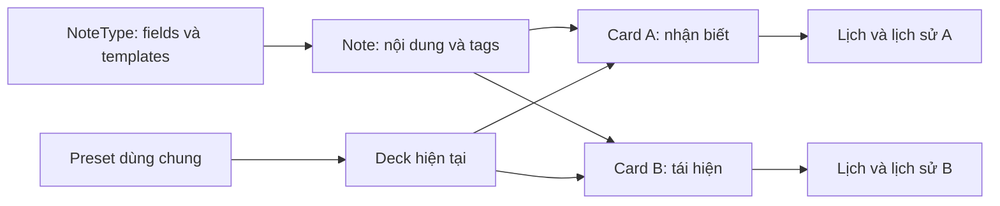
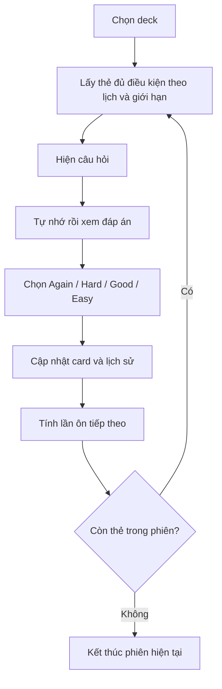

# Phân tích Business / nghiệp vụ Anki

Ngày phân tích: **02/11/2026**, múi giờ Việt Nam. Đối tượng: [ankitects/anki](https://github.com/ankitects/anki), bản source tại commit [`136bd42bfbd35`](https://github.com/ankitects/anki/tree/136bd42bfbd356fc756b6d3e28cc77b02da11ea7). File `.version`: `26.09.3`; đây là snapshot nhánh `main`, không phải xác nhận source trùng hoàn toàn release cùng số phiên bản.

## 1. Kết luận điều hành

**Anki cung cấp một vòng lặp quản lý trí nhớ cá nhân: tạo kiến thức cần nhớ → tự kiểm tra → phản hồi mức nhớ → xếp lịch ôn tiếp theo → điều chỉnh khối lượng học.** Giá trị sản phẩm nằm ở việc quyết định *học gì vào lúc nào* dựa trên lịch sử từng thẻ, kết hợp quyền kiểm soát nội dung của người học. Đây là diễn giải nghiệp vụ từ luồng review và mô hình dữ liệu, không phải số liệu đo hiệu quả học tập. [S1][S2]

Ba đặc trưng chi phối thiết kế nghiệp vụ:

1. **Tách nội dung và việc học:** một `Note` có thể sinh nhiều `Card`; lịch ôn thuộc card. Nhớ chiều Anh → Việt không đồng nghĩa đã nhớ chiều Việt → Anh. [S1]
2. **Người học cung cấp tín hiệu đánh giá:** sau khi xem đáp án, người học chọn mức nhớ; scheduler dùng phản hồi để tính trạng thái/lịch tiếp theo. Luồng chuẩn không tự xác định mức hiểu kiến thức của người học. [S2]
3. **Dữ liệu học có tính tích lũy:** nội dung, lịch sử review, tham số học và đồng bộ cùng phục vụ việc duy trì quá trình học lâu dài. Tầm quan trọng của lịch sử đối với sản phẩm là suy luận BA; cơ chế lưu/sync được đối chiếu trong báo cáo dữ liệu. [C]

Về kinh doanh, desktop miễn phí, AnkiWeb có dịch vụ đồng bộ miễn phí; doanh thu bán AnkiMobile được công bố là nguồn hỗ trợ phát triển Anki. Không có bằng chứng trong phạm vi này về doanh thu thực tế, tỷ lệ chuyển đổi hay lợi nhuận. [W1][S3]

## 2. Ranh giới phân tích

| Thành phần | Vai trò | Mức khảo sát |
|---|---|---|
| Anki Desktop | Soạn nội dung, học/ôn, quản lý bộ sưu tập, thống kê, import/export, add-on | Đọc source và manual trong repo |
| Lõi Rust + Python bridge + PyQt + giao diện TypeScript/Svelte | Thực hiện quy tắc nghiệp vụ trên desktop | Truy vết tĩnh các điểm liên quan; không build/chạy |
| AnkiWeb | Dịch vụ liên quan đến đồng bộ, shared decks và add-ons | Đọc mô tả chính thức, giao thức/client trong repo; không kết luận nội bộ dịch vụ |
| AnkiMobile / AnkiDroid | Học trên di động trong hệ sinh thái | Chỉ đối chiếu ranh giới và mô hình hỗ trợ dự án; không phân tích source hai app |

README xác định repo chứa phiên bản máy tính. Repo cũng có mã sync server phục vụ self-hosting; điều đó không chứng minh toàn bộ website/hạ tầng AnkiWeb nằm trong repo. [S4][C]

Nhãn chứng cứ sử dụng: **Code** = đọc được trong mã; **Docs** = manual/tài liệu công bố; **REA** = quan sát tĩnh có Evidence ID; **Suy luận BA** = diễn giải/đề xuất, cần kiểm chứng với người dùng hoặc dữ liệu thực tế.

## 3. Người dùng và công việc cần hoàn thành

Các nhóm dưới đây là phân khúc nghiệp vụ, **không phải các role phân quyền có sẵn**. Một người có thể đồng thời học và soạn nội dung.

| Nhóm | Công việc cần làm | Giá trị mong đợi | Chức năng liên quan |
|---|---|---|---|
| Người học ngoại ngữ | Nhớ từ, câu, phát âm theo nhiều chiều | Duy trì khả năng nhớ qua thời gian | Note/card nhiều chiều, audio, lịch ôn |
| Người ôn thi hoặc kiến thức chuyên môn | Quản lý lượng kiến thức lớn và các phần hay quên | Phân bổ thời gian học theo mức cần ôn | Cloze, image occlusion, tags, filtered deck |
| Người tự xây kho kiến thức | Biến tài liệu cá nhân thành câu hỏi kiểm tra | Chủ động nội dung và cách hiển thị | Fields, note types, templates, media |
| Người chia sẻ nội dung | Đóng gói và cung cấp deck cho người khác | Tái sử dụng công sức soạn thẻ | Import/export, shared-deck workflow |
| Người dùng nâng cao / tác giả add-on | Thay đổi hoặc mở rộng thao tác học | Thích nghi với nhu cầu đặc thù | Add-on manager, hooks, cấu hình |
| Người duy trì / cộng tác viên | Cải thiện phần mềm, bản dịch, hỗ trợ | Duy trì chất lượng hệ sinh thái | Repo, đóng góp, diễn đàn |

Ứng dụng học ngôn ngữ/chuyên môn được nêu trong tài liệu; việc nhóm thành các phân khúc và mô tả lợi ích là **Suy luận BA**. Chưa có nghiên cứu persona, quy mô từng phân khúc hoặc mức sẵn sàng chi trả. [S5][S3][C]

## 4. Bản đồ năng lực nghiệp vụ

| Nhóm năng lực | Đầu vào → kết quả | Ý nghĩa nghiệp vụ | Chứng cứ |
|---|---|---|---|
| Soạn kiến thức | Fields + note type + nội dung → note/card | Soạn một lần, sinh các cách kiểm tra phù hợp | [S1][C] |
| Biểu diễn câu hỏi | Templates, cloze, hình che vùng, media → câu hỏi/đáp án | Hỗ trợ nhiều dạng kiến thức | [C] |
| Tổ chức nội dung | Deck/subdeck, tags, tìm kiếm → tập thẻ cần thao tác | Tách phạm vi học và phân loại nội dung | [C] |
| Học và đánh giá | Câu hỏi → xem đáp án → rating → lịch mới | Vòng lặp cốt lõi của sản phẩm | [S2][L] |
| Kiểm soát khối lượng | Giới hạn ngày, preset, FSRS, bury/suspend → hàng đợi học | Cân bằng tiến độ và công sức | [L][S6] |
| Ôn theo nhu cầu | Điều kiện tìm kiếm → filtered deck | Ôn một tập mục tiêu ngoài luồng thường ngày | [L] |
| Theo dõi | Lịch sử review → thống kê | Nhận biết tiến độ, khối lượng và kết quả ôn | [L] |
| Di chuyển và bảo toàn dữ liệu | Import/export, sync, backup → dữ liệu có thể tái sử dụng/khôi phục | Duy trì việc học qua thời gian và thiết bị | [C] |
| Mở rộng | Add-on → bổ sung hành vi | Cộng đồng hỗ trợ các nhu cầu chuyên biệt | [S7] |

## 5. Mô hình nghiệp vụ dữ liệu

| Đối tượng | Ý nghĩa | Quan hệ cần giữ đúng |
|---|---|---|
| Profile / Collection | Không gian dữ liệu học cục bộ | Profile gắn collection; không tương đương tenant hay role doanh nghiệp |
| NoteType | Định nghĩa cấu trúc nội dung và cách sinh thẻ | Một note dùng một note type; kiểu này có field definitions và card templates |
| Note | Một đơn vị kiến thức có cấu trúc | Chứa field values và tags; không thuộc trực tiếp một deck |
| Card | Một cách kiểm tra note | Thuộc một note, có thông tin template, deck hiện tại và trạng thái/lịch học riêng |
| Deck | Nhóm card để tổ chức và học | Có thể phân cấp; deck thường tham chiếu preset; filtered deck có ngữ nghĩa riêng |
| Preset / DeckConfig | Nhóm lựa chọn học dùng chung | Nhiều deck dùng chung; thay đổi preset có thể ảnh hưởng nhiều deck |
| ReviewLog | Dấu vết lịch sử học/thao tác liên quan | Liên kết card; có rating, thời gian và dữ liệu lịch học tùy loại bản ghi |
| Media | Ảnh, âm thanh và tài nguyên nội dung | Nội dung tham chiếu file; không coi là tài sản độc quyền của một deck |

Mô hình khái niệm giản lược; không phải sơ đồ khóa ngoại vật lý. [C]

Ví dụ: note `apple / quả táo / ảnh minh họa` có thể sinh hai thẻ hỏi ngược chiều. Sửa nghĩa trong note sẽ thay đổi nội dung hiển thị liên quan; việc trả lời đúng card A không đồng thời hoàn thành card B. **Không dùng công thức “mỗi note luôn sinh đúng số template” cho mọi trường hợp**: điều kiện sinh card, cloze và image occlusion cần quy tắc riêng. [S1][C]

## 6. Luồng nghiệp vụ chính

### 6.1. Tạo nội dung và bắt đầu học

1. Người dùng chọn hoặc tạo deck, chọn note type.
2. Nhập field values; thêm tags/media khi cần.
3. Hệ thống kiểm tra nội dung và sinh các card phù hợp.
4. Người dùng chọn deck và bắt đầu học; hàng đợi xét card đủ điều kiện cùng các giới hạn.
5. Card chưa được học được đưa vào quy trình học theo cấu hình.

Ngoại lệ cần hiểu: nội dung trùng không phải lúc nào cũng bị từ chối tuyệt đối; template không sinh được câu hỏi có thể dẫn đến card rỗng/cần xử lý; không phải tất cả card mới đều được học ngay trong ngày. [C][L]

### 6.2. Học hằng ngày

“Hoàn tất hôm nay” nghĩa là hết card có thể đưa ra trong phiên theo điều kiện hiện tại; **không đồng nghĩa đã nhớ toàn bộ collection hoặc không còn backlog**. [L]

Nhánh ngoại lệ: quên → Again; card cần sửa → chỉnh note; cần tạm tránh trong ngày → bury; cần ngừng học vô thời hạn → suspend; quên lặp lại → xử lý leech theo cấu hình. Chi tiết trạng thái/điều kiện trong [báo cáo học](../plans/reports/learning-business.md). [L]

### 6.3. Điều chỉnh chính sách học

Người dùng mở Deck Options → chọn preset/giới hạn → tùy chọn FSRS → lưu. Từ REA, xác định được module `DeckOptionsState`, hàm `save` và import backend. Đọc source tiếp cho thấy `dataForSaving` gửi deck mục tiêu, preset thay đổi, giới hạn, cờ FSRS và lựa chọn reschedule; Rust thực hiện trong transaction và kiểm tra tham số trước khi lưu. **Chỉ quan sát được chuỗi tĩnh, chưa chạy thao tác UI.** [R][S6][S8]

Ảnh hưởng cần thông báo cho người dùng: preset dùng chung có thể ảnh hưởng nhiều deck; bật FSRS là lựa chọn toàn collection; lựa chọn reschedule có thể thay đổi ngày đến hạn của các card liên quan. [S8][L]

### 6.4. Nhập/chia sẻ và học trên nhiều thiết bị

Nhập file → chọn mapping/chính sách cập nhật → thêm hoặc cập nhật nội dung → kiểm tra kết quả → học. Với thiết bị khác: đồng bộ collection và media → tiếp tục học → đồng bộ thay đổi. Import, sync và restore backup là ba nghiệp vụ khác nhau, không dùng thay thế khái niệm cho nhau. [C]

Ngoại lệ chính: text import và package import không có cùng khóa nhận diện trùng; note sửa đồng thời trên nhiều thiết bị không được ghép từng field; one-way sync yêu cầu chọn phía dữ liệu; backup tự động không bao gồm media. Quy tắc chi tiết trong [báo cáo nội dung và dữ liệu](../plans/reports/content-business.md). [C]

## 7. Các quy tắc nghiệp vụ trọng yếu

Đây là danh mục để hiểu/đặc tả sản phẩm; mã BR là nhãn của báo cáo, không phải mã có sẵn trong Anki.

| Mã | Quy tắc | Hệ quả nghiệp vụ | Căn cứ |
|---|---|---|---|
| BR-01 | Note giữ kiến thức; card giữ lần kiểm tra và lịch học riêng | Không gộp note với card trong đặc tả/dữ liệu | Code + Docs [C] |
| BR-02 | Tags thuộc note; deck và flag thuộc card | Thao tác lọc/gắn nhãn có phạm vi khác nhau | Code + Docs [C] |
| BR-03 | Luồng review chuẩn nhận rating sau khi đã hiện đáp án | Không coi bấm nút trước khi xem đáp án là review hợp lệ | Code [S2] |
| BR-04 | Again = không nhớ/sai; Hard = nhớ được nhưng khó | Hard không thay cho Again; phản hồi sai làm lệch tín hiệu lịch học | Docs + Code [L] |
| BR-05 | New, Learning, Review, Relearning mô tả các giai đoạn học; đường chuyển phụ thuộc steps và scheduler | Không hard-code một chuỗi trạng thái/interval cho mọi cấu hình | Code [L] |
| BR-06 | Giới hạn ngày và phạm vi deck chi phối số thẻ được học | Số card trong kho khác số card của phiên | Code + Docs [L] |
| BR-07 | Bury khác suspend; sibling bury có các lựa chọn theo loại card | Tạm ẩn trong ngày khác ngừng học đến khi mở lại | Code + Docs [L] |
| BR-08 | Leech được phát hiện từ lapse theo ngưỡng/cấu hình | Có thể gắn tag và/hoặc suspend; không phải mọi lần quên đều thành leech | Code [L] |
| BR-09 | FSRS bật/tắt toàn collection; params theo preset và retention có thể override theo deck | Không thiết kế cờ FSRS độc lập cho từng deck | Code [S8] |
| BR-10 | Desired retention là mục tiêu mô hình; tăng mục tiêu thường tăng lượng ôn | Không diễn giải thành cam kết điểm thi hoặc bảo đảm nhớ | Docs; hệ quả BA [L] |
| BR-11 | Reschedule là lựa chọn riêng khi thay đổi FSRS/cấu hình | Không coi mọi thay đổi cấu hình đều tính lại toàn bộ due date | Code [S8] |
| BR-12 | Filtered deck tập hợp card bằng tìm kiếm; có chế độ reschedule/preview | Không xem là bản sao độc lập của nội dung gốc | Code [L] |
| BR-13 | Kiểm tra trùng khi soạn/text import/package import dùng các điều kiện khác nhau | Cần đặc tả từng entry point, không viết một rule trùng chung | Code + Docs [C] |
| BR-14 | Sync note chọn bản ghi theo logic mtime/usn; không merge field | Hai thiết bị sửa hai field khác nhau vẫn có thể mất một thay đổi | Code [C] |
| BR-15 | Full upload/download thay thế một phía collection; media được xử lý riêng | Cần phân biệt chiều đồng bộ và phạm vi dữ liệu | Code + Docs [C] |
| BR-16 | Backup tự động không chứa media | Khôi phục collection không bảo đảm khôi phục đầy đủ ảnh/âm thanh | Docs [C] |

Các nguồn dòng cụ thể, điều kiện và ngoại lệ của từng nhóm được lưu ở [L] và [C]; bảng này không thay thế đặc tả thuật toán scheduler.

## 8. Mô hình kinh doanh và hệ sinh thái

### Những gì đã được công bố

- **Kênh tiếp cận:** phần mềm desktop miễn phí trên các nền tảng chính; website giới thiệu ứng dụng và liên kết tài liệu/cộng đồng. [W1]
- **Dịch vụ bổ trợ:** AnkiWeb cung cấp đồng bộ miễn phí. [W1]
- **Nguồn tài trợ phát triển:** mua AnkiMobile giúp hỗ trợ phát triển Anki. AnkiDroid do đội khác phát triển và có kênh quyên góp riêng. Không đồng nhất hai nguồn tài trợ. [S3][W1]
- **Đóng góp ngoài tiền:** hỗ trợ trên diễn đàn, giới thiệu sản phẩm, đóng góp code/nội dung/bản dịch. [S3][W1]
- **Giấy phép được repo khai báo:** AGPL-3.0-or-later, có các phần được liệt kê theo giấy phép khác; docs-site có giấy phép tài liệu riêng. Đây là ghi nhận nội dung LICENSE, không phải đánh giá nghĩa vụ pháp lý cho một phương án thương mại hóa. [S9]

### Diễn giải BA

Anki vận hành theo mô hình **sản phẩm mở, desktop miễn phí và ứng dụng iOS có thu phí hỗ trợ phát triển**, kèm đóng góp cộng đồng. Không đủ chứng cứ để gọi đây là mô hình thuê bao SaaS, thị trường mua bán deck có hoa hồng hoặc sản phẩm kiếm tiền từ quảng cáo.

Vòng lặp giá trị có thể diễn giải như sau: người dùng có nội dung phù hợp → duy trì review → tích lũy lịch sử học → điều chỉnh lịch theo cá nhân → tiếp tục sử dụng. Shared decks giảm công soạn ban đầu; add-on mở rộng nhu cầu phục vụ; import/export giúp người dùng di chuyển nội dung. Đây là giả thuyết về động lực sử dụng, chưa phải phân tích causal hay số liệu retention khách hàng. [L][C][S7]

Năng lực khó sao chép hoàn chỉnh nằm ở sự kết hợp của lịch học cá nhân, mô hình note/card/template, xử lý dữ liệu nhiều năm và tương thích hệ sinh thái. **“Có FSRS” riêng lẻ chưa diễn tả đủ sản phẩm.** Đây là nhận định phân tích, không phải kết quả so sánh cạnh tranh đã đo.

## 9. Hàm ý sản phẩm và chỉ số nên theo dõi

Các mục này là **đề xuất đánh giá**, không phải tính năng mới đã triển khai hay telemetry được tìm thấy trong repo.

| Vấn đề nghiệp vụ | Hướng kiểm chứng/cải thiện | Chỉ số đề xuất |
|---|---|---|
| Người mới dễ nhầm Note với Card | Kiểm tra khả năng hiểu bằng bài tạo một note có hai chiều | Tỷ lệ hoàn tất tạo nội dung và phiên học đầu |
| Phản hồi Hard/Again thiếu nhất quán | Kiểm tra cách người dùng hiểu các mức đánh giá | Tỷ lệ đánh giá đúng theo tình huống mẫu |
| Thêm quá nhiều card tạo khối lượng ôn lớn về sau | Đánh giá khả năng hiểu giới hạn ngày và backlog | Số card quá hạn, thời gian học/ngày, tỷ lệ hoàn tất kế hoạch |
| Import/sync/backup dễ bị hiểu như nhau | Kiểm tra người dùng có chọn đúng thao tác khi chuyển máy/khôi phục | Tỷ lệ hoàn tất tác vụ, lỗi hoặc mất dữ liệu được xác nhận |
| Tùy chọn nâng cao làm tăng tải nhận thức | Thử nghiệm khả năng chọn preset/retention mà hiểu ảnh hưởng | Tỷ lệ cấu hình thành công và nhu cầu hỗ trợ |

Khi đo hiệu quả học, nên xem đồng thời kết quả nhớ, thời gian và khối lượng; chỉ tăng số lượt review không tự chứng minh học tốt hơn. Khi đo tăng trưởng sản phẩm, cần dữ liệu riêng về activation, quay lại sử dụng và trả phí; repo không cung cấp cơ sở để ước lượng các con số này.

## 10. REA đã đóng góp gì và giới hạn nào còn lại?

Đã chạy thật `analyze_javascript_application` trên `sources/anki/ts/routes/deck-options`, xem summary/module view và xuất Evidence. **Đầu vào là source TypeScript, không phải gói Anki phát hành hay runtime đang hoạt động.**

| Hạng mục | Kết quả |
|---|---|
| Parent Evidence | `ev_b577322d29549c59bbc0cdf59e6481ea2e6fa3b6269a6ba6cc0a9bff8caf398d` |
| Summary Evidence | `ev_9eaddc70d59e0afd5748bbe751d09b02ed5a13e0cf4088dd553ab1f2f7cc0bf8` |
| Module `lib.ts` view | `ev_29c4a2aeb317ce16448c8777c09f67cdc1b75f2d3e53b64824099a41539bac29` |
| SHA-256 input tree theo REA | `7a5e83769d0a9cca1fc6d262491eb34b2bcd324c3eec853f54dd9dc34d9325ac` |
| Phạm vi parser | 7 file TypeScript, gồm 2 file test; 39.883 byte text; 4.684 AST nodes; 121 findings; 0 parse failures |
| Quan sát hữu ích | Export `DeckOptionsState`, `createLimits`, `fsrsParams`; import `getDeckConfigsForUpdate` và `updateDeckConfigs`; vị trí hàm `save` trong `lib.ts` |
| Giới hạn quan trọng | Backend import có trạng thái `external`; không được resolve thành triển khai Rust trong phạm vi REA này |
| Ngữ nghĩa chưa xác định | 1.036 semantic unknowns; semantic coverage `unknown`; không dùng application coverage `complete` để kết luận toàn ứng dụng đã được phân tích |

**Kết luận được hỗ trợ:** module giao diện có bề mặt quản lý preset/giới hạn/FSRS và các điểm gọi backend. Quy tắc lưu, tính lại lịch, sync và sinh card trong báo cáo dựa thêm vào việc đọc code/manual, không gán cho REA khả năng đã chứng minh chúng.

REA dùng nhãn authority tổng quát `shipped-artifact` trong output; báo cáo không dùng nhãn đó để suy ra đây là bản release. Không phân tích đầy đủ Svelte UI, không thực thi JavaScript, không kiểm thử UI/sync, không chạy test/build của Anki. File Evidence có `unknowns: []` ở ledger vẫn tồn tại 1.036 unknowns trong semantic graph: hai cấu trúc có ý nghĩa khác nhau.

- [Bằng chứng REA đầy đủ, JSON](../evidence/rea-deck-options.json).
- [Trích xuất nhỏ: import backend, hàm save, phạm vi và giới hạn](../evidence/rea-business-extract.json).

## 11. Nguồn và truy vết

- [L]: [Báo cáo học/lập lịch: quy tắc và source line](../plans/reports/learning-business.md).
- [C]: [Báo cáo nội dung/import/sync: mô hình và source line](../plans/reports/content-business.md).
- [R]: [Bộ bằng chứng REA](../evidence/rea-deck-options.json).
- Các link GitHub dưới đây được cố định theo commit; website là thông tin truy cập ngày 02/11/2026.

## 12. Điểm chưa xác minh / câu hỏi còn mở

1. Hành vi runtime và thao tác UI thực tế chưa được chạy trong lần phân tích này.
2. Quy mô người dùng, doanh thu, chi phí vận hành, phân khúc trả phí và conversion chưa có dữ liệu.
3. Nội bộ dịch vụ hosted AnkiWeb, kiến trúc riêng của AnkiMobile/AnkiDroid nằm ngoài phạm vi repo được khảo sát.
4. Hai chỗ manual/code cần xác nhận thêm: mô tả bury đối với interday learning; cách diễn giải “lần review đầu tiên trong ngày” của chỉ số true retention. Xem chứng cứ và giới hạn trong [L]; chưa kết luận đây là bug runtime.
5. Chính sách media khi hai thiết bị sửa cùng filename chưa khảo sát đủ. Các ngoại lệ package import `Always` với timestamp bằng nhau và fallback sinh card rỗng đã ghi trong [C]; chưa chạy runtime để kết luận ý nghĩa sản phẩm của mọi trường hợp.

[S1]: https://github.com/ankitects/anki/blob/136bd42bfbd356fc756b6d3e28cc77b02da11ea7/docs-site/manual/getting-started.mdx#L106
[S2]: https://github.com/ankitects/anki/blob/136bd42bfbd356fc756b6d3e28cc77b02da11ea7/qt/aqt/reviewer.py#L532
[S3]: https://github.com/ankitects/anki/blob/136bd42bfbd356fc756b6d3e28cc77b02da11ea7/docs-site/faqs/how-can-i-donate.mdx#L7
[S4]: https://github.com/ankitects/anki/blob/136bd42bfbd356fc756b6d3e28cc77b02da11ea7/README.md
[S5]: https://github.com/ankitects/anki/blob/136bd42bfbd356fc756b6d3e28cc77b02da11ea7/docs-site/manual/background.mdx#L30
[S6]: https://github.com/ankitects/anki/blob/136bd42bfbd356fc756b6d3e28cc77b02da11ea7/ts/routes/deck-options/lib.ts#L247
[S7]: https://github.com/ankitects/anki/blob/136bd42bfbd356fc756b6d3e28cc77b02da11ea7/qt/aqt/addons.py#L446
[S8]: https://github.com/ankitects/anki/blob/136bd42bfbd356fc756b6d3e28cc77b02da11ea7/rslib/src/deckconfig/update.rs#L160
[S9]: https://github.com/ankitects/anki/blob/136bd42bfbd356fc756b6d3e28cc77b02da11ea7/LICENSE
[W1]: https://apps.ankiweb.net/
[L]: ../plans/reports/learning-business.md
[C]: ../plans/reports/content-business.md
[R]: ../evidence/rea-deck-options.json
