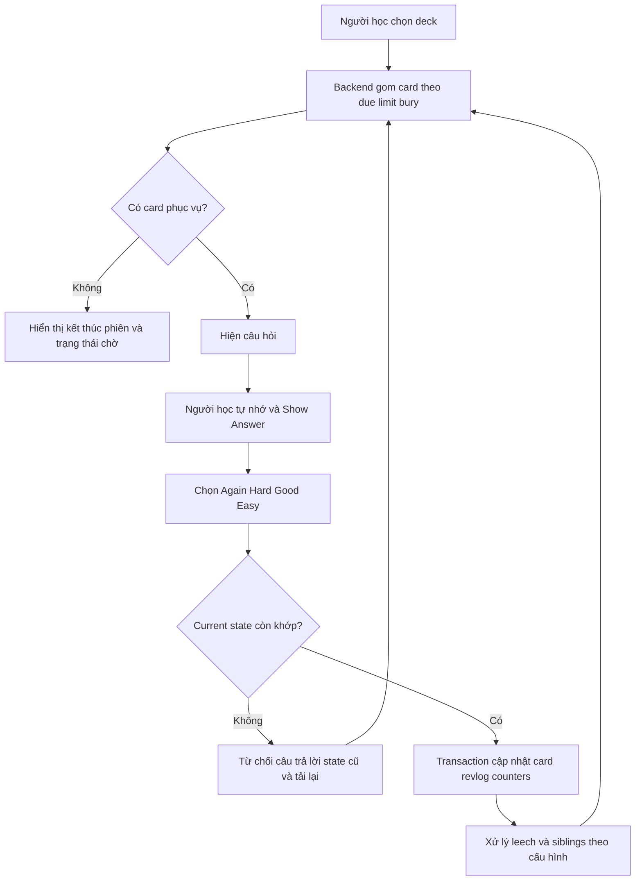
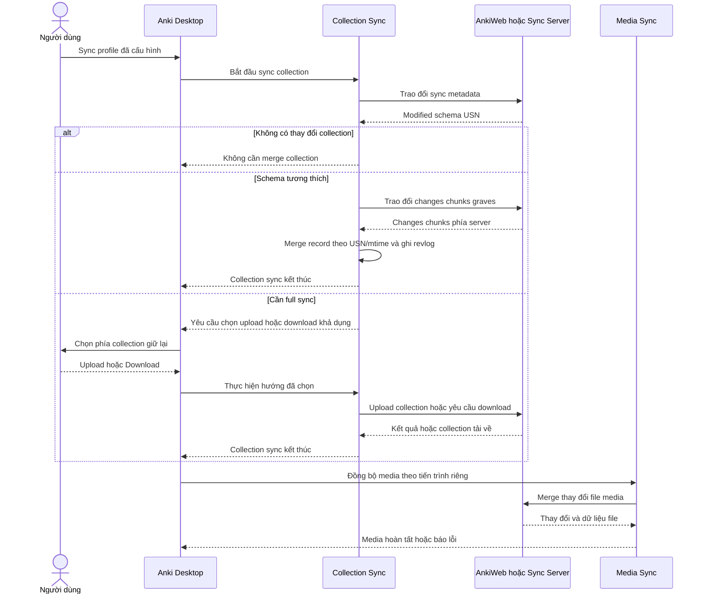
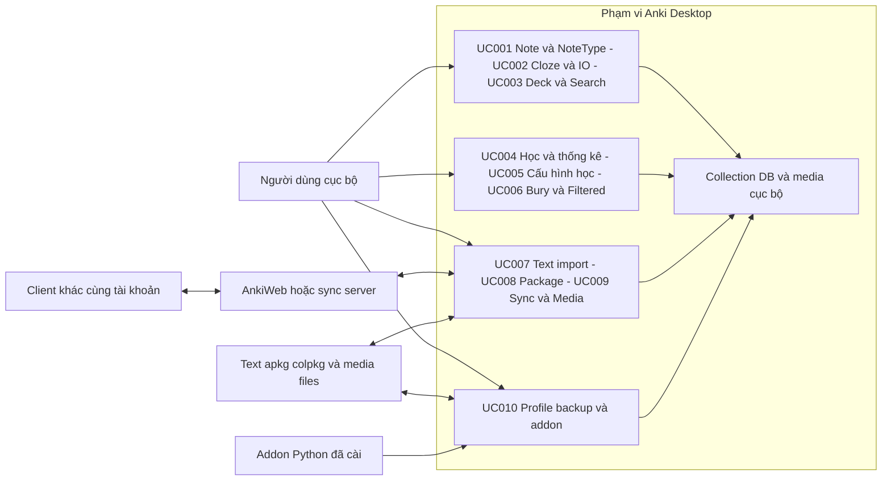

# Sơ đồ luồng và ranh giới hệ thống Anki

**As-Is — DRAFT v1.0.0**, commit `136bd42bfbd356fc756b6d3e28cc77b02da11ea7`. Phân tích tĩnh, chưa chạy runtime; không phải quy tắc sản phẩm mới.

## Lịch sử sửa đổi

| Phiên bản | Ngày | Tác giả | Nội dung |
|---|---|---|---|
| 1.0.0 | 2026-11-02 | BA Agent | Baseline As-Is, guard và giới hạn từ source |

## DIAG-ACT-ANKI-001 — Học một phiên

| Bước | FR / UC | Ý nghĩa |
|---|---|---|
| Gom card | FR-LRN-LIM-001; UC-ANKI-004 | Limit không đồng nghĩa không còn backlog; intraday learning có cách xử lý riêng |
| Tự chấm | FR-LRN-REV-001; UC-ANKI-004 | Hệ thống nhận rating, không tự xác minh mức hiểu |
| Ghi kết quả | FR-LRN-SCH-001; UC-ANKI-004 | Transaction; state cũ có thể bị từ chối |
| Leech/bury | FR-LRN-HIDE-001; UC-ANKI-006 | Tác động queue, không “đã thuộc” |

[qt/aqt/reviewer.py:532](https://github.com/ankitects/anki/blob/136bd42bfbd356fc756b6d3e28cc77b02da11ea7/qt/aqt/reviewer.py#L532); [rslib/src/scheduler/answering/mod.rs:315](https://github.com/ankitects/anki/blob/136bd42bfbd356fc756b6d3e28cc77b02da11ea7/rslib/src/scheduler/answering/mod.rs#L315); [rslib/src/scheduler/queue/builder/mod.rs:130](https://github.com/ankitects/anki/blob/136bd42bfbd356fc756b6d3e28cc77b02da11ea7/rslib/src/scheduler/queue/builder/mod.rs#L130).

## DIAG-SEQ-ANKI-001 — Đồng bộ collection và media

| Điều kiện | Diễn giải / giới hạn |
|---|---|
| Sơ đồ thứ tự | Mô hình nghiệp vụ; không khẳng định implementation bắt buộc chạy media sau collection tuần tự như hình |
| Merge | Theo record; không ghép từng field note |
| Full sync | Upload/download thay một phía collection; không ép media theo cùng chiều |
| Kết thúc collection | Hook sync_did_finish không bảo đảm media đã hoàn tất |
| Lỗi/mất mạng | Không báo cả collection lẫn media thành công khi mới hoàn tất một phần; người dùng kiểm tra trạng thái rồi retry |

FR-DAT-SYNC-001, FR-DAT-MEDI-001; UC-ANKI-009. Nguồn: [rslib/src/sync/collection/meta.rs:59](https://github.com/ankitects/anki/blob/136bd42bfbd356fc756b6d3e28cc77b02da11ea7/rslib/src/sync/collection/meta.rs#L59); [rslib/src/sync/collection/chunks.rs:162](https://github.com/ankitects/anki/blob/136bd42bfbd356fc756b6d3e28cc77b02da11ea7/rslib/src/sync/collection/chunks.rs#L162); [qt/tools/genhooks_gui.py:933](https://github.com/ankitects/anki/blob/136bd42bfbd356fc756b6d3e28cc77b02da11ea7/qt/tools/genhooks_gui.py#L933); [docs-site/manual/syncing.mdx:59](https://github.com/ankitects/anki/blob/136bd42bfbd356fc756b6d3e28cc77b02da11ea7/docs-site/manual/syncing.mdx#L59).

## DIAG-CTX-ANKI-001 — Context và bản đồ use case

| Actor/biên | Vai trò và phạm vi |
|---|---|
| Người dùng cục bộ | Người học/soạn nội dung/quản lý cấu hình là vai trò mục tiêu, không phải role RBAC khác nhau |
| Server | Dịch vụ hỗ trợ sync; source desktop không chứng minh nội bộ hosted AnkiWeb |
| Mobile | Client bên ngoài phạm vi source được phân tích |
| Files | Đầu vào/đầu ra; không phải actor có quyền người dùng |
| Addon | Extension trong desktop; hooks có phạm vi riêng, không bao phủ mọi entry point |
| UC010 | Mục tiêu mức Kite: quản lý môi trường học; các thao tác profile/backup/addon là nhánh độc lập, không buộc phải chạy cùng một lần |

[README.md:9](https://github.com/ankitects/anki/blob/136bd42bfbd356fc756b6d3e28cc77b02da11ea7/README.md#L9); [docs-site/manual/profiles.mdx:5](https://github.com/ankitects/anki/blob/136bd42bfbd356fc756b6d3e28cc77b02da11ea7/docs-site/manual/profiles.mdx#L5); [pylib/tools/genhooks.py:29](https://github.com/ankitects/anki/blob/136bd42bfbd356fc756b6d3e28cc77b02da11ea7/pylib/tools/genhooks.py#L29).

## Câu hỏi mở

Không thêm teacher/admin/RBAC hay dịch vụ thanh toán vào context: chưa có bằng chứng thuộc các luồng khảo sát. Chưa kiểm thử trình tự runtime; các hình mô tả mục tiêu và tương tác đã đối chiếu tĩnh.

## Liên kết yêu cầu chuẩn

Catalog [requirements.json](../srs/requirements.json) v1.0.0.

- FR: FR-LRN-REV-001, FR-LRN-LIM-001, FR-DAT-SYNC-001, FR-DAT-MEDI-001, FR-EXT-ADD-001.
- BR: BR-ANKI-006, BR-ANKI-008, BR-ANKI-011, BR-ANKI-012, BR-ANKI-023, BR-ANKI-028, BR-ANKI-026, BR-ANKI-027.
- ERR: ERR-ANKI-000-03.
