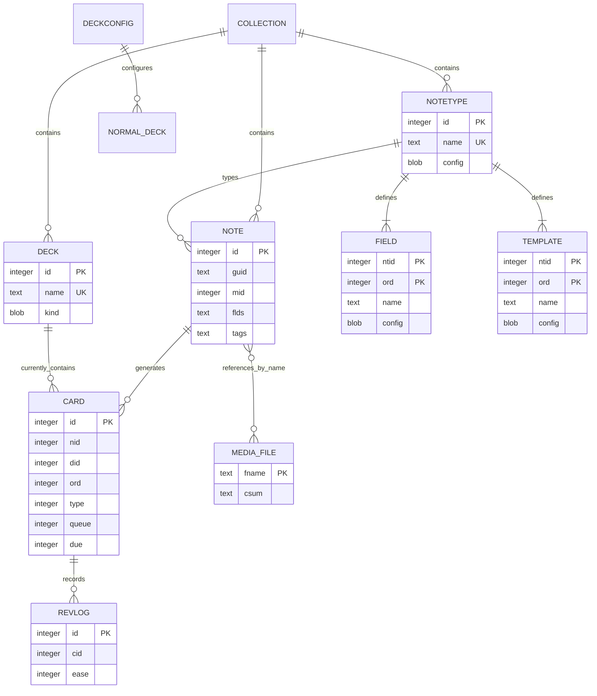

# Mô hình dữ liệu và từ điển dữ liệu Anki

**As-Is — DRAFT v1.0.0.** Snapshot `136bd42bfbd356fc756b6d3e28cc77b02da11ea7`. Đọc source/manual, chưa kiểm thử runtime; không phải thiết kế thay thế hay tài liệu được Anki phê duyệt.

## Lịch sử sửa đổi

| Phiên bản | Ngày | Tác giả | Thay đổi |
|---|---|---|---|
| 1.0.0 | 2026-11-02 | BA Agent | Khởi tạo baseline As-Is từ source đã cố định |

## Phạm vi và quy ước

Bao phủ dữ liệu lõi phục vụ 20 FR trong SRS; trọng tâm FR-CNT-NOTE-001, FR-CNT-TYPE-001, FR-ORG-DECK-001, FR-LRN-SCH-001, FR-DAT-SYNC-001, FR-DAT-MEDI-001. `Field` định nghĩa thuộc NoteType khác với giá trị field nằm trong Note. `Template` ở code chứa cả question và answer format; “card type” trên UI không phải `cards.type` của scheduler.

- ERD là quan hệ logic. `FK logic` trong từ điển **không khẳng định SQLite FOREIGN KEY**. Các DDL đã đối chiếu không khai báo FOREIGN KEY cho các quan hệ này. PK/unique index nào được thực thi được ghi riêng.
- `INTEGER/TEXT/BLOB` là kiểu khai báo SQLite; không có giới hạn độ dài kiểu VARCHAR(n) trong các bảng này. Rust/protobuf có miền số riêng; không đồng nhất SQL INTEGER với u32.
- Không có SQL DEFAULT trừ khi ghi rõ; giá trị do ứng dụng cấp không phải default của database. `—` ở độ dài nghĩa là DDL không đặt giới hạn, không có nghĩa file/input vô hạn.
- Schema hiện đại tách fields/templates/notetypes/decks/config ra bảng; không đọc JSON `col.models/decks/dconf` cũ như nguồn chuẩn duy nhất. Profile là biên file/cấu hình UI, không phải bảng `users` hoặc tenant/RBAC trong collection.

[rslib/src/storage/schema11.sql:1](https://github.com/ankitects/anki/blob/136bd42bfbd356fc756b6d3e28cc77b02da11ea7/rslib/src/storage/schema11.sql#L1); [rslib/src/storage/upgrades/schema14_upgrade.sql:1](https://github.com/ankitects/anki/blob/136bd42bfbd356fc756b6d3e28cc77b02da11ea7/rslib/src/storage/upgrades/schema14_upgrade.sql#L1); [rslib/src/storage/upgrades/schema15_upgrade.sql:1](https://github.com/ankitects/anki/blob/136bd42bfbd356fc756b6d3e28cc77b02da11ea7/rslib/src/storage/upgrades/schema15_upgrade.sql#L1); [rslib/src/storage/upgrades/schema18_upgrade.sql:1](https://github.com/ankitects/anki/blob/136bd42bfbd356fc756b6d3e28cc77b02da11ea7/rslib/src/storage/upgrades/schema18_upgrade.sql#L1).

## DIAG-ERD-ANKI-001 — Quan hệ logic lõi

| Quan hệ / ký hiệu | Diễn giải và giới hạn |
|---|---|
| Collection → dữ liệu | Containment của file collection; các bảng con không có cột collection_id |
| NoteType → Field/Template | 1..n là validation ứng dụng; DB không kiểm tra số lượng dòng con |
| Note → Card | Dùng 0..n cho mô hình lưu trữ; luồng thường bảo đảm ít nhất một card, xóa card cuối qua luồng xóa xử lý orphan note |
| Card → Template | Normal: note.mid + card.ord xác định template; Cloze: ord là số cloze trừ một và luôn dùng template đầu. Không vẽ FK ord đơn giản vì sẽ sai với Cloze |
| DeckConfig → NormalDeck | NORMAL_DECK là subtype khái niệm của DECK, không phải bảng mới; config_id nằm trong protobuf kind; filtered deck có cấu hình riêng |
| Card → ReviewLog | Mỗi log có cid, không có FK cưỡng chế; không suy ra mọi log luôn còn card hiện hữu |
| Note ↔ Media | Tham chiếu tên file trong nội dung; không có join table hay FK; file có thể chưa được dùng hoặc tham chiếu bị thiếu |

[rslib/src/notes/mod.rs:42](https://github.com/ankitects/anki/blob/136bd42bfbd356fc756b6d3e28cc77b02da11ea7/rslib/src/notes/mod.rs#L42); [rslib/src/card/mod.rs:80](https://github.com/ankitects/anki/blob/136bd42bfbd356fc756b6d3e28cc77b02da11ea7/rslib/src/card/mod.rs#L80); [rslib/src/notetype/mod.rs:132](https://github.com/ankitects/anki/blob/136bd42bfbd356fc756b6d3e28cc77b02da11ea7/rslib/src/notetype/mod.rs#L132); [rslib/src/notetype/mod.rs:484](https://github.com/ankitects/anki/blob/136bd42bfbd356fc756b6d3e28cc77b02da11ea7/rslib/src/notetype/mod.rs#L484); [rslib/src/card/mod.rs:348](https://github.com/ankitects/anki/blob/136bd42bfbd356fc756b6d3e28cc77b02da11ea7/rslib/src/card/mod.rs#L348); [proto/anki/decks.proto:72](https://github.com/ankitects/anki/blob/136bd42bfbd356fc756b6d3e28cc77b02da11ea7/proto/anki/decks.proto#L72).

### notes

Nguồn: [rslib/src/storage/schema11.sql:16](https://github.com/ankitects/anki/blob/136bd42bfbd356fc756b6d3e28cc77b02da11ea7/rslib/src/storage/schema11.sql#L16); [rslib/src/notes/mod.rs:42](https://github.com/ankitects/anki/blob/136bd42bfbd356fc756b6d3e28cc77b02da11ea7/rslib/src/notes/mod.rs#L42).

| Tên trường (Logical) | Cột/path physical | Kiểu dữ liệu | Độ dài | Null? | Khóa | Ràng buộc / mặc định | Diễn giải nghiệp vụ |
|---|---|---|---|---|---|---|---|
| Mã note | id | INTEGER / NoteId(i64) | — | Không | PK | Không SQL DEFAULT | Định danh nội bộ |
| GUID | guid | TEXT / String | — | Không | — | Không SQL DEFAULT | Nhận diện note qua package/text import; DDL không UNIQUE |
| Kiểu note | mid | INTEGER / NotetypeId(i64) | — | Không | FK logic | Không SQL DEFAULT | Tham chiếu notetypes.id |
| Lần sửa | mod | INTEGER / TimestampSecs | — | Không | — | Không SQL DEFAULT | Unix seconds; dùng chọn phiên bản |
| Số sync | usn | INTEGER / Usn(i32) | — | Không | — | Không SQL DEFAULT | Đánh dấu đồng bộ; client pending dùng -1 |
| Tags | tags | TEXT / Vec<String> khi đọc | — | Không | — | Không SQL DEFAULT | Danh sách tags cấp note, lưu dạng phân cách |
| Giá trị fields | flds | TEXT / Vec<String> khi đọc | — | Không | — | Không SQL DEFAULT | Nối bằng U+001F; số giá trị phải khớp NoteType |
| Field sắp xếp | sfld | INTEGER affinity / chuỗi hoặc số | — | Không | — | Không SQL DEFAULT | Khai báo INTEGER cố ý để giá trị số xếp đúng |
| Checksum field đầu | csum | INTEGER / u32 | — | Không | — | Không SQL DEFAULT | Index không UNIQUE; hỗ trợ phát hiện trùng |
| Flags cũ | flags | INTEGER | — | Không | — | Không SQL DEFAULT | Cột legacy; không nhầm card flag |
| Dữ liệu cũ | data | TEXT | — | Không | — | Không SQL DEFAULT | Cột legacy; không gán nghĩa nghiệp vụ mới |

### cards

Nguồn: [rslib/src/storage/schema11.sql:31](https://github.com/ankitects/anki/blob/136bd42bfbd356fc756b6d3e28cc77b02da11ea7/rslib/src/storage/schema11.sql#L31); [rslib/src/card/mod.rs:44](https://github.com/ankitects/anki/blob/136bd42bfbd356fc756b6d3e28cc77b02da11ea7/rslib/src/card/mod.rs#L44).

| Tên trường (Logical) | Cột/path physical | Kiểu dữ liệu | Độ dài | Null? | Khóa | Ràng buộc / mặc định | Diễn giải nghiệp vụ |
|---|---|---|---|---|---|---|---|
| Mã card | id | INTEGER / CardId(i64) | — | Không | PK | Không SQL DEFAULT | Định danh card |
| Note gốc | nid | INTEGER / NoteId(i64) | — | Không | FK logic | Không SQL DEFAULT | Tham chiếu notes.id |
| Deck hiện tại | did | INTEGER / DeckId(i64) | — | Không | FK logic | Không SQL DEFAULT | Tham chiếu decks.id |
| Ordinal | ord | INTEGER / u16 | — | Không | — | Không SQL DEFAULT | Template ordinal với Normal; cloze ordinal với Cloze |
| Lần sửa | mod | INTEGER / TimestampSecs | — | Không | — | Không SQL DEFAULT | Unix seconds |
| Số sync | usn | INTEGER / Usn(i32) | — | Không | — | Không SQL DEFAULT | Pending/phiên bản đồng bộ |
| Giai đoạn học | type | INTEGER / CardType(u8) | — | Không | — | Không SQL DEFAULT | 0 New; 1 Learn; 2 Review; 3 Relearn |
| Queue | queue | INTEGER / CardQueue(i8) | — | Không | — | Không SQL DEFAULT | 0 New,1 Learn,2 Review,3 DayLearn,4 PreviewRepeat,-1 Suspended,-2 SchedBuried,-3 UserBuried |
| Hạn/vị trí | due | INTEGER / i32 | — | Không | — | Không SQL DEFAULT | New: vị trí; Learn/PreviewRepeat: Unix seconds; Review/DayLearn: số ngày tương đối collection |
| Khoảng ôn | ivl | INTEGER / u32 | — | Không | — | Không SQL DEFAULT | Số ngày interval trên card |
| Hệ số ease | factor | INTEGER / u16 | — | Không | — | Không SQL DEFAULT | Dữ liệu scheduler legacy; không dùng làm công thức FSRS |
| Lượt trả lời | reps | INTEGER / u32 | — | Không | — | Không SQL DEFAULT | Bộ đếm trên card |
| Số lần lapse | lapses | INTEGER / u32 | — | Không | — | Không SQL DEFAULT | Quên trong review; không tăng mỗi Again trong chuỗi relearn |
| Steps còn lại | left | INTEGER / u32 | — | Không | — | Không SQL DEFAULT | Biểu diễn remaining_steps trong model |
| Due gốc | odue | INTEGER / i32 | — | Không | — | Không SQL DEFAULT | Thông tin phục hồi với filtered deck |
| Deck gốc | odid | INTEGER / DeckId(i64) | — | Không | FK logic có sentinel | Không SQL DEFAULT | 0 khi không có deck gốc; khác 0 tham chiếu decks.id |
| Flag | flags | INTEGER / u8 | — | Không | — | Không SQL DEFAULT | Flag cấp card, không tags |
| Dữ liệu mở rộng | data | TEXT / JSON | — | Không | — | Không SQL DEFAULT | FSRS state và custom scheduling state; xem dưới |

### cards.data — các trường đã đối chiếu

Nguồn: [rslib/src/storage/card/data.rs:17](https://github.com/ankitects/anki/blob/136bd42bfbd356fc756b6d3e28cc77b02da11ea7/rslib/src/storage/card/data.rs#L17).

| Tên trường (Logical) | Cột/path physical | Kiểu dữ liệu | Độ dài | Null? | Khóa | Ràng buộc / mặc định | Diễn giải nghiệp vụ |
|---|---|---|---|---|---|---|---|
| Vị trí ban đầu | data.pos | JSON number / Option<u32> | — | Có: key có thể thiếu | — | None bỏ khỏi JSON | Vị trí new queue trước khi rời |
| Stability | data.s | JSON number / Option<f32> | — | Có: key có thể thiếu | — | None bỏ khỏi JSON | Memory stability FSRS |
| Difficulty | data.d | JSON number / Option<f32> | — | Có: key có thể thiếu | — | None bỏ khỏi JSON | Memory difficulty FSRS |
| Retention đích | data.dr | JSON number / Option<f32> | — | Có: key có thể thiếu | — | None bỏ khỏi JSON | Desired retention |
| Decay | data.decay | JSON number / Option<f32> | — | Có: key có thể thiếu | — | None bỏ khỏi JSON | Tham số decay |
| Lần review gần nhất | data.lrt | JSON number / Option<TimestampSecs> | — | Có: key có thể thiếu | — | None bỏ khỏi JSON | Unix seconds |
| Custom data | data.cd | JSON string / String | — | Key có thể thiếu | — | Serde default; rỗng có thể bỏ | Chuỗi JSON object do custom scheduling sử dụng |

### notetypes, fields, templates

Nguồn: [rslib/src/storage/upgrades/schema15_upgrade.sql:1](https://github.com/ankitects/anki/blob/136bd42bfbd356fc756b6d3e28cc77b02da11ea7/rslib/src/storage/upgrades/schema15_upgrade.sql#L1); [proto/anki/notetypes.proto:47](https://github.com/ankitects/anki/blob/136bd42bfbd356fc756b6d3e28cc77b02da11ea7/proto/anki/notetypes.proto#L47).

| Tên trường (Logical) | Cột/path physical | Kiểu dữ liệu | Độ dài | Null? | Khóa | Ràng buộc / mặc định | Diễn giải nghiệp vụ |
|---|---|---|---|---|---|---|---|
| Mã kiểu | notetypes.id | INTEGER / int64 | — | Không | PK | Không SQL DEFAULT | Định danh NoteType |
| Tên kiểu | notetypes.name | TEXT / string | — | Không | Unique | Không SQL DEFAULT | Unique với COLLATE unicase |
| Sửa kiểu | notetypes.mtime_secs | INTEGER / int64 | — | Không | — | Không SQL DEFAULT | Unix seconds |
| Sync kiểu | notetypes.usn | INTEGER / sint32 | — | Không | — | Không SQL DEFAULT | Phiên bản sync |
| Cấu hình kiểu | notetypes.config | BLOB / Notetype.Config | — | Không | — | Không SQL DEFAULT | Protobuf: kind NORMAL/CLOZE, css, sort_field_idx, original_id… |
| Kiểu chủ field | fields.ntid | INTEGER / i64 | — | Không | PK phần 1; FK logic | Không SQL DEFAULT | Tham chiếu notetypes.id |
| Vị trí field | fields.ord | INTEGER / u32 | — | Không | PK phần 2 | Không SQL DEFAULT | Vị trí trong NoteType |
| Tên field | fields.name | TEXT / string | — | Không | Unique(name,ntid) | Không SQL DEFAULT | Tên duy nhất trong một NoteType |
| Cấu hình field | fields.config | BLOB / Field.Config | — | Không | — | Không SQL DEFAULT | font, rtl, sticky, optional id/tag, prevent_deletion… |
| Kiểu chủ template | templates.ntid | INTEGER / i64 | — | Không | PK phần 1; FK logic | Không SQL DEFAULT | Tham chiếu notetypes.id |
| Vị trí template | templates.ord | INTEGER / u32 | — | Không | PK phần 2 | Không SQL DEFAULT | Ordinal trong NoteType |
| Tên template | templates.name | TEXT / string | — | Không | Unique(name,ntid) | Không SQL DEFAULT | Tên duy nhất trong một NoteType |
| Sửa template | templates.mtime_secs | INTEGER / int64 | — | Không | — | Không SQL DEFAULT | Unix seconds |
| Sync template | templates.usn | INTEGER / sint32 | — | Không | — | Không SQL DEFAULT | Phiên bản sync |
| Cấu hình template | templates.config | BLOB / Template.Config | — | Không | — | Không SQL DEFAULT | q_format/a_format, browser format, target_deck_id, optional id |

### decks và deck_config

Nguồn: [rslib/src/storage/upgrades/schema15_upgrade.sql:29](https://github.com/ankitects/anki/blob/136bd42bfbd356fc756b6d3e28cc77b02da11ea7/rslib/src/storage/upgrades/schema15_upgrade.sql#L29); [rslib/src/storage/upgrades/schema14_upgrade.sql:1](https://github.com/ankitects/anki/blob/136bd42bfbd356fc756b6d3e28cc77b02da11ea7/rslib/src/storage/upgrades/schema14_upgrade.sql#L1); [proto/anki/decks.proto:54](https://github.com/ankitects/anki/blob/136bd42bfbd356fc756b6d3e28cc77b02da11ea7/proto/anki/decks.proto#L54).

| Tên trường (Logical) | Cột/path physical | Kiểu dữ liệu | Độ dài | Null? | Khóa | Ràng buộc / mặc định | Diễn giải nghiệp vụ |
|---|---|---|---|---|---|---|---|
| Mã deck | decks.id | INTEGER / int64 | — | Không | PK | Không SQL DEFAULT | Định danh deck |
| Tên deck | decks.name | TEXT / string | — | Không | Unique | Không SQL DEFAULT | Tên cây; UI dùng ::; unique unicase |
| Sửa deck | decks.mtime_secs | INTEGER / int64 | — | Không | — | Không SQL DEFAULT | Unix seconds |
| Sync deck | decks.usn | INTEGER / int32 | — | Không | — | Không SQL DEFAULT | Số sync |
| Phần chung | decks.common | BLOB / Deck.Common | — | Không | — | Không SQL DEFAULT | Collapsed, last_day_studied, new/review/milliseconds_studied |
| Loại deck | decks.kind | BLOB / Deck.KindContainer | — | Không | — | Không SQL DEFAULT | oneof Normal hoặc Filtered |
| Preset deck thường | decks.kind.normal.config_id | protobuf int64 | — | Không | FK logic | Không SQL DEFAULT | Tham chiếu deck_config.id; không là cột SQL riêng |
| Limit override | decks.kind.normal.new_limit/review_limit | protobuf optional uint32 | — | Có thể absent | — | Không SQL DEFAULT | Override deck; absent dùng preset |
| Limit hôm nay | decks.kind.normal.new_limit_today/review_limit_today | protobuf DayLimit | — | Message có thể absent | — | Không SQL DEFAULT | uint32 limit + uint32 today |
| Retention override | decks.kind.normal.desired_retention | protobuf optional float | — | Có thể absent | — | Không SQL DEFAULT | Override retention cấp deck |
| Tìm thẻ tạm | decks.kind.filtered.search_terms | repeated SearchTerm | — | Không | — | Có thể danh sách rỗng | string search + uint32 limit + enum order |
| Đổi lịch khi ôn | decks.kind.filtered.reschedule | protobuf bool | — | Không | — | Scalar protobuf default false; không khẳng định UI default | Phân biệt reschedule và preview |
| Mã preset | deck_config.id | INTEGER / int64 | — | Không | PK | Không SQL DEFAULT | Preset dùng chung |
| Tên preset | deck_config.name | TEXT / string | — | Không | — | Không SQL DEFAULT | COLLATE unicase; DDL này không unique name |
| Sửa preset | deck_config.mtime_secs | INTEGER / int64 | — | Không | — | Không SQL DEFAULT | Unix seconds |
| Sync preset | deck_config.usn | INTEGER / int32 | — | Không | — | Không SQL DEFAULT | Số sync |
| Nội dung preset | deck_config.config | BLOB / DeckConfig.Config | — | Không | — | Không SQL DEFAULT | Protobuf cấu hình scheduling; không là JSON ad-hoc |

### revlog

Nguồn: [rslib/src/storage/schema11.sql:52](https://github.com/ankitects/anki/blob/136bd42bfbd356fc756b6d3e28cc77b02da11ea7/rslib/src/storage/schema11.sql#L52); [rslib/src/revlog/mod.rs:35](https://github.com/ankitects/anki/blob/136bd42bfbd356fc756b6d3e28cc77b02da11ea7/rslib/src/revlog/mod.rs#L35).

| Tên trường (Logical) | Cột/path physical | Kiểu dữ liệu | Độ dài | Null? | Khóa | Ràng buộc / mặc định | Diễn giải nghiệp vụ |
|---|---|---|---|---|---|---|---|
| Mã log | id | INTEGER / RevlogId(i64) | — | Không | PK | Không SQL DEFAULT | Định danh gắn timestamp milliseconds |
| Card | cid | INTEGER / CardId(i64) | — | Không | FK logic | Không SQL DEFAULT | Card liên quan; không FK cưỡng chế |
| Sync | usn | INTEGER / Usn(i32) | — | Không | — | Không SQL DEFAULT | Số sync |
| Rating | ease | INTEGER / u8 | — | Không | — | Không SQL DEFAULT | 1..4 rating thường; 0 manual rescheduling; legacy v1 có nghĩa riêng |
| Interval mới | ivl | INTEGER / i32 | — | Không | — | Không SQL DEFAULT | Dương: ngày; âm: giây |
| Interval cũ | lastIvl | INTEGER / i32 | — | Không | — | Không SQL DEFAULT | Dương: ngày; âm: giây |
| Ease/difficulty | factor | INTEGER / u32 | — | Không | — | Không SQL DEFAULT | SM-2: ease x10%; FSRS difficulty chuẩn hóa 100..1100 |
| Thời gian trả lời | time | INTEGER / u32 | — | Không | — | Không SQL DEFAULT | Milliseconds, bị cap theo cấu hình trước ghi |
| Loại log | type | INTEGER / enum u8 | — | Không | — | Không SQL DEFAULT | 0 Learning,1 Review,2 Relearning,3 Filtered,4 Manual,5 Rescheduled |

### Metadata collection / sync / tags

Nguồn: [rslib/src/storage/schema11.sql:1](https://github.com/ankitects/anki/blob/136bd42bfbd356fc756b6d3e28cc77b02da11ea7/rslib/src/storage/schema11.sql#L1); [rslib/src/storage/upgrades/schema17_upgrade.sql:1](https://github.com/ankitects/anki/blob/136bd42bfbd356fc756b6d3e28cc77b02da11ea7/rslib/src/storage/upgrades/schema17_upgrade.sql#L1); [rslib/src/storage/upgrades/schema18_upgrade.sql:1](https://github.com/ankitects/anki/blob/136bd42bfbd356fc756b6d3e28cc77b02da11ea7/rslib/src/storage/upgrades/schema18_upgrade.sql#L1).

| Tên trường (Logical) | Cột/path physical | Kiểu dữ liệu | Độ dài | Null? | Khóa | Ràng buộc / mặc định | Diễn giải nghiệp vụ |
|---|---|---|---|---|---|---|---|
| Mã collection | col.id | INTEGER | — | Không | PK | Không SQL DEFAULT | Một hàng metadata chính |
| Ngày tạo | col.crt | INTEGER | — | Không | — | Không SQL DEFAULT | Timestamp tạo collection; không nhầm ID note |
| Lần sửa | col.mod | INTEGER | — | Không | — | Không SQL DEFAULT | Timestamp milliseconds |
| Schema đổi | col.scm | INTEGER | — | Không | — | Không SQL DEFAULT | Timestamp milliseconds, quyết định full sync |
| Phiên bản schema | col.ver | INTEGER | — | Không | — | Không SQL DEFAULT | Phiên bản lưu trữ, khác phiên bản sản phẩm |
| Dirty legacy | col.dty | INTEGER | — | Không | — | Không SQL DEFAULT | Metadata legacy |
| Sync collection | col.usn | INTEGER | — | Không | — | Không SQL DEFAULT | Số sequence sync |
| Sync cuối | col.ls | INTEGER | — | Không | — | Không SQL DEFAULT | Metadata lần sync |
| JSON legacy | col.conf/models/decks/dconf/tags | TEXT | — | Không | — | Không SQL DEFAULT | Các cột tương thích cũ; schema mới có bảng tách |
| Key config | config.key | TEXT | — | Không | PK | Không SQL DEFAULT | Tên cấu hình |
| Config sync | config.usn | INTEGER | — | Không | — | Không SQL DEFAULT | Số sync |
| Config sửa | config.mtime_secs | INTEGER | — | Không | — | Không SQL DEFAULT | Unix seconds |
| Config value | config.val | BLOB | — | Không | — | Không SQL DEFAULT | Giá trị serialized; schema không quy định domain riêng từng key |
| Tag | tags.tag | TEXT | — | Không | PK | Không SQL DEFAULT | Registry tag, unicase |
| Tag sync | tags.usn | INTEGER | — | Không | — | Không SQL DEFAULT | Số sync |
| Thu gọn tag | tags.collapsed | BOOLEAN | — | Không | — | Không SQL DEFAULT | Trạng thái cây tag |
| Cấu hình tag | tags.config | BLOB | — | Có | — | Không SQL DEFAULT | Config bổ sung |
| Đối tượng xóa | graves.oid | INTEGER | — | Không | PK phần 1 | Không SQL DEFAULT | ID đối tượng đã xóa |
| Loại xóa | graves.type | INTEGER | — | Không | PK phần 2 | Không SQL DEFAULT | Phân biệt loại đối tượng; không FK tới hàng đã xóa |
| Sync xóa | graves.usn | INTEGER | — | Không | — | Không SQL DEFAULT | Tombstone phục vụ lan truyền xóa |

### Media sync database — tách khỏi collection DB

Nguồn: [rslib/src/sync/media/database/client/schema.sql:1](https://github.com/ankitects/anki/blob/136bd42bfbd356fc756b6d3e28cc77b02da11ea7/rslib/src/sync/media/database/client/schema.sql#L1).

| Tên trường (Logical) | Cột/path physical | Kiểu dữ liệu | Độ dài | Null? | Khóa | Ràng buộc / mặc định | Diễn giải nghiệp vụ |
|---|---|---|---|---|---|---|---|
| Tên file | media.fname | TEXT | — | Không | PK | Không SQL DEFAULT | Khóa tên file trong thư mục media |
| Checksum | media.csum | TEXT | — | Có | — | Không SQL DEFAULT | NULL biểu thị file bị xóa |
| Thời gian file | media.mtime | INT | — | Không | — | Không SQL DEFAULT | 0 khi bị xóa |
| Dirty | media.dirty | INT | — | Không | — | Không SQL DEFAULT | 1 có thay đổi cần sync; partial index dirty=1 |
| Thời gian thư mục | meta.dirMod | INT | — | Có theo DDL | — | INSERT ban đầu 0 | Snapshot thư mục; hàng khởi tạo 0 |
| USN cuối | meta.lastUsn | INT | — | Có theo DDL | — | INSERT ban đầu 0 | Tiến độ media sync; hàng khởi tạo 0 |

## Ràng buộc nghiệp vụ ngoài DDL

- Số field values khớp số field definitions; validation ứng dụng, không phải CHECK SQL. GUID/first-field trùng không phải UNIQUE constraint; entry point quyết định update/preserve/duplicate.
- Một Card có một deck hiện tại; `odid` lưu home deck khi cần. Normal deck và filtered deck là hai nhánh protobuf khác nhau.
- FSRS memory state không thêm entity “đã thuộc”; người học tiếp tục có thể quên và review lại.
- Media không nằm trong backup tự động; `.colpkg` có Include Media mới mang asset theo.

[rslib/src/notes/mod.rs:198](https://github.com/ankitects/anki/blob/136bd42bfbd356fc756b6d3e28cc77b02da11ea7/rslib/src/notes/mod.rs#L198); [rslib/src/import_export/text/import.rs:318](https://github.com/ankitects/anki/blob/136bd42bfbd356fc756b6d3e28cc77b02da11ea7/rslib/src/import_export/text/import.rs#L318); [docs-site/manual/backups.mdx:7](https://github.com/ankitects/anki/blob/136bd42bfbd356fc756b6d3e28cc77b02da11ea7/docs-site/manual/backups.mdx#L7).

## Câu hỏi mở

Không khẳng định schema cho mọi phiên bản/mobile. Cấu hình protobuf được mô tả theo trường nghiệp vụ đã khảo sát; các trường legacy/opaque không suy diễn thành yêu cầu mới. Owner xác minh runtime: maintainer Anki nếu cần chuyển DRAFT thành đặc tả triển khai.

## Liên kết yêu cầu chuẩn

Catalog [requirements.json](requirements.json) v1.0.0.

- FR: FR-CNT-NOTE-001, FR-CNT-TYPE-001, FR-ORG-DECK-001, FR-LRN-SCH-001, FR-DAT-SYNC-001, FR-DAT-MEDI-001.
- BR: BR-ANKI-001, BR-ANKI-003, BR-ANKI-002, BR-ANKI-006, BR-ANKI-012, BR-ANKI-009, BR-ANKI-010, BR-ANKI-011, BR-ANKI-013, BR-ANKI-023, BR-ANKI-028.
- ERR: ERR-ANKI-000-01, ERR-ANKI-000-02, ERR-ANKI-000-03.
