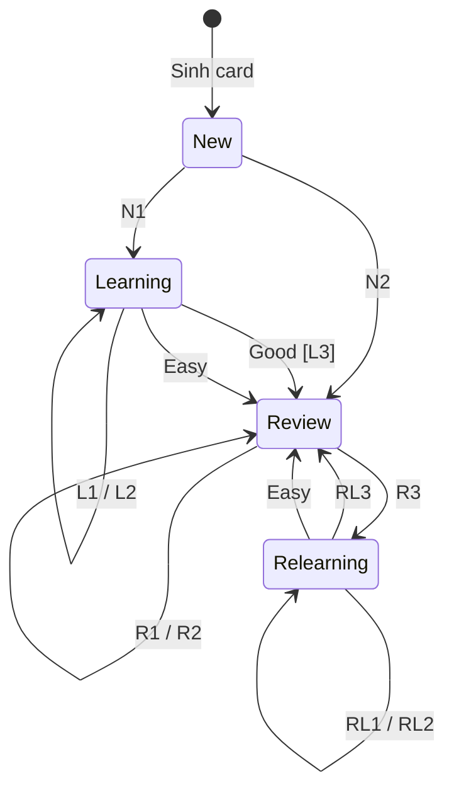
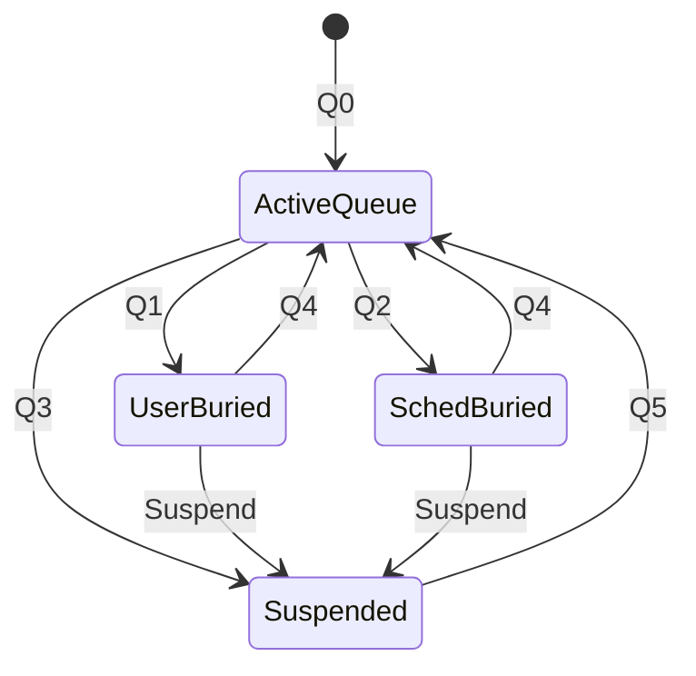

# Trạng thái Card và điều kiện chuyển

**As-Is — DRAFT v1.0.0**, commit `136bd42bfbd356fc756b6d3e28cc77b02da11ea7`. Phân tích tĩnh, chưa chạy runtime; không phải quy tắc sản phẩm mới.

## Lịch sử sửa đổi

| Phiên bản | Ngày | Tác giả | Nội dung |
|---|---|---|---|
| 1.0.0 | 2026-11-02 | BA Agent | Baseline As-Is; bổ sung guard Good/FSRS short-term theo learning.rs:145 và relearning.rs:174 trong review trước phát hành |

## Phân biệt ba lớp trạng thái

- `cards.type`: New=0, Learn=1, Review=2, Relearn=3 — giai đoạn học.
- `cards.queue`: tính đủ điều kiện/phân loại hàng đợi, gồm cả giá trị âm bury/suspend. Một card không giữ đồng thời hai giá trị queue.
- API `SchedulingState`: normal hoặc filtered; filtered phân biệt preview và rescheduling filter. Không gộp vào một enum phẳng.

Ban đầu là New; **không có trạng thái terminal “Mastered/đã thuộc”**. Xóa card là kết thúc tồn tại dữ liệu, không phải kết quả học thành công; không đưa terminal giả vào scheduler để thỏa mẫu FSM. Scope FR-LRN-REV-001, FR-LRN-SCH-001, FR-LRN-FSRS-001, FR-LRN-HIDE-001, FR-LRN-FILT-001.

[rslib/src/card/mod.rs:42](https://github.com/ankitects/anki/blob/136bd42bfbd356fc756b6d3e28cc77b02da11ea7/rslib/src/card/mod.rs#L42); [proto/anki/scheduler.proto:80](https://github.com/ankitects/anki/blob/136bd42bfbd356fc756b6d3e28cc77b02da11ea7/proto/anki/scheduler.proto#L80).

## DIAG-STATE-ANKI-001 — Giai đoạn normal study

Các mã trên cạnh chỉ rút ngắn nhãn để hình không chồng chữ; bảng dưới là phần bắt buộc đọc cùng hình. Dấu `/` phân tách các trường hợp thay thế, không phải chuỗi thao tác.

| Mã / cạnh trên hình | Trigger và điều kiện |
|---|---|
| N1 | Answer của New dùng logic Learning và trả kết quả Learning |
| N2 | Answer của New dùng logic Learning và trả kết quả Review; không suy ra chỉ từ steps rỗng |
| L1 | Again hoặc Hard khi scheduler trả Learning |
| L2 | Good còn delay từ steps hoặc guard Good short-term Learning đúng |
| L3 | Good không còn delay từ steps và guard Good short-term Learning sai → Review |
| Learning → Review: Easy | Hàm Easy trả ReviewState riêng, không dùng guard của Good |
| R1 | Hard, Good hoặc Easy: Review → Review |
| R2 | Again khi scheduler không yêu cầu relearning: Review → Review |
| R3 | Again khi scheduler yêu cầu học lại ngắn hạn: Review → Relearning |
| RL1 | Again hoặc Hard khi scheduler trả Relearning |
| RL2 | Good còn delay từ relearn_steps hoặc guard Good short-term Relearning đúng |
| RL3 | Good không còn delay từ relearn_steps và guard Good short-term Relearning sai → Review |
| Relearning → Review: Easy | Hàm Easy trả ReviewState riêng, không dùng guard của Good |
| Phạm vi hình | Chỉ normal study; không có terminal Mastered. Preview/filtered và queue âm được mô tả riêng |

### Guard của Good sau khi không còn delay từ steps

- Với Learning: có `fsrs_next_states`, `fsrs_allow_short_term=true`, (`fsrs_short_term_with_steps_enabled=true` **hoặc** `steps.is_empty()`), và `states.good.interval < 0.5` ngày → vẫn **Learning**, delay tính bằng `interval * 86_400` giây.
- Với Relearning: guard tương tự nhưng kiểm tra `relearn_steps.is_empty()` → vẫn **Relearning**.
- Khi không còn delay từ steps và guard tương ứng sai, Good trả **Review**. Easy có hàm riêng trả `ReviewState`; không gộp guard với Good.
- Nếu còn delay từ steps, nhánh Good theo steps được xét trước nhánh FSRS short-term; vì vậy “hết steps” không đủ để kết luận tốt nghiệp.

Nguồn: [learning.rs:133](https://github.com/ankitects/anki/blob/136bd42bfbd356fc756b6d3e28cc77b02da11ea7/rslib/src/scheduler/states/learning.rs#L133), [learning.rs:180](https://github.com/ankitects/anki/blob/136bd42bfbd356fc756b6d3e28cc77b02da11ea7/rslib/src/scheduler/states/learning.rs#L180), [relearning.rs:133](https://github.com/ankitects/anki/blob/136bd42bfbd356fc756b6d3e28cc77b02da11ea7/rslib/src/scheduler/states/relearning.rs#L133), [relearning.rs:187](https://github.com/ankitects/anki/blob/136bd42bfbd356fc756b6d3e28cc77b02da11ea7/rslib/src/scheduler/states/relearning.rs#L187).

### Ma trận chuyển normal

| Nguồn | Trigger | Guard | Đích | Vai trò | Side effects / nguồn |
|---|---|---|---|---|---|
| Chưa có Card | Add note/generate | NoteType và nội dung hợp lệ; cần ordinal mới | New | Người soạn + backend | Sinh card; không ghi review rating |
| New | Answer rating | Scheduler dùng logic Learning; kết quả trả Learning do steps hoặc short-term | Learning | Người học | Lưu queue/due/remaining_steps và review log |
| New | Answer rating | Scheduler dùng logic Learning; kết quả thực tế trả Review, không chỉ dựa vào steps rỗng | Review | Người học | Lưu interval/due từ scheduler |
| Learning | Again | Có learning steps | Learning | Người học | Về bước đầu |
| Learning | Hard | Có learning steps | Learning | Người học | Lặp delay; bước đầu có quy tắc delay riêng |
| Learning | Good | Còn step tiếp theo | Learning | Người học | Tiến step |
| Learning | Good | Không còn delay từ steps; guard Good short-term Learning đúng | Learning | Người học | Delay theo interval FSRS nhân 86.400 giây; chưa tốt nghiệp |
| Learning | Good | Không còn delay từ steps; guard Good short-term Learning sai | Review | Người học | Interval review có fuzz và giới hạn |
| Learning | Easy | Câu trả lời được chấp nhận | Review | Người học | Hàm answer_easy trả ReviewState riêng |
| Review | Hard/Good/Easy | Current state vẫn khớp | Review | Người học | Tính interval/memory state, ghi log |
| Review | Again | Scheduler chọn relearning | Relearning | Người học | Tăng lapse, tính interval học lại; có thể phát leech |
| Review | Again | Không cần relearning steps/nhánh short-term tương ứng | Review hoặc Relearning theo kết quả tính | Người học | Không tự ép một đích khi cấu hình khác nhau |
| Relearning | Again/Hard | Scheduler trả kết quả Relearning | Relearning | Người học | Again không cộng thêm lapse review gốc mỗi lần |
| Relearning | Good | Còn delay từ relearn_steps | Relearning | Người học | Tiến bước học lại |
| Relearning | Good | Không còn delay từ relearn_steps; guard Good short-term Relearning đúng | Relearning | Người học | Delay theo interval FSRS nhân 86.400 giây |
| Relearning | Good | Không còn delay từ relearn_steps; guard Good short-term Relearning sai | Review | Người học | FSRS trả good_review; không FSRS trả review nền |
| Relearning | Easy | Câu trả lời được chấp nhận | Review | Người học | Hàm answer_easy trả ReviewState riêng |
| Bất kỳ normal | AnswerCard | State hiện tại khác state đã hiển thị ngoài chênh thời gian cho phép | Không commit câu trả lời | Backend | Từ chối state cũ; UI cần tải trạng thái hiện tại |

Nguồn ma trận: [rslib/src/scheduler/states/normal.rs:40](https://github.com/ankitects/anki/blob/136bd42bfbd356fc756b6d3e28cc77b02da11ea7/rslib/src/scheduler/states/normal.rs#L40); [rslib/src/scheduler/states/learning.rs:39](https://github.com/ankitects/anki/blob/136bd42bfbd356fc756b6d3e28cc77b02da11ea7/rslib/src/scheduler/states/learning.rs#L39); [rslib/src/scheduler/states/review.rs:95](https://github.com/ankitects/anki/blob/136bd42bfbd356fc756b6d3e28cc77b02da11ea7/rslib/src/scheduler/states/review.rs#L95); [rslib/src/scheduler/states/relearning.rs:37](https://github.com/ankitects/anki/blob/136bd42bfbd356fc756b6d3e28cc77b02da11ea7/rslib/src/scheduler/states/relearning.rs#L37); [rslib/src/scheduler/answering/mod.rs:315](https://github.com/ankitects/anki/blob/136bd42bfbd356fc756b6d3e28cc77b02da11ea7/rslib/src/scheduler/answering/mod.rs#L315).

## DIAG-STATE-ANKI-002 — Queue overlay

| Nhãn cạnh | Trigger / điều kiện |
|---|---|
| Q0 | Card đủ điều kiện theo type và due |
| Q1 | Bury thủ công |
| Q2 | Sibling bury đủ điều kiện |
| Q3 | Suspend thủ công hoặc leech được cấu hình suspend |
| Q4 | Unbury hoặc đổi ngày scheduler; không áp dụng cho Suspended |
| Q5 | Unsuspend thủ công |
| Suspend | Chuyển từ một queue buried sang Suspended |

| Queue | Mã | Đơn vị due / ý nghĩa |
|---|---|---|
| New | 0 | Vị trí thẻ mới |
| Learn | 1 | Unix timestamp giây |
| Review | 2 | Ngày tương đối collection |
| DayLearn | 3 | Ngày tương đối collection; learning qua ngày |
| PreviewRepeat | 4 | Unix timestamp giây, lặp preview |
| Suspended | -1 | Không được gom học tới khi unsuspend |
| SchedBuried | -2 | Bị scheduler bury |
| UserBuried | -3 | Bị người dùng bury |

`ActiveQueue` là nhóm khái niệm gồm 0..4, không phải enum mới trong code. Hình bỏ qua chuyển qua lại hai loại bury; bảng sau là authority.

### Ma trận overlay và filtered

| Nguồn | Trigger | Guard | Đích | Vai trò | Hệ quả |
|---|---|---|---|---|---|
| Queue không suspended | BuryUser/BurySched | Queue khác đích; scheduler được hỗ trợ | -3 / -2 | Người học / scheduler | Giữ type nền; cập nhật card |
| Suspended | Bury | Guard ngăn bury suspended | Giữ -1 | Người học / scheduler | Không vô tình unsuspend |
| Queue không suspended | Suspend | Queue khác -1 | -1 | Người học / leech handler | Dừng đưa vào phiên; không terminal học |
| Buried | Day rollover | Scheduler day đã thay đổi | Phục hồi queue theo card | Scheduler | Không áp dụng unsuspend cho -1 |
| Buried/Suspended | Unbury/Unsuspend | Card còn tồn tại | Phục hồi queue theo type/due | Người học | Đánh dấu card modified |
| Card ở home deck | Rebuild filtered | Match search; không buried/suspended; không ở filtered khác | Filtered | Người học | Giữ home deck, không sao chép note/card |
| Filtered reschedule | Answer | Kết quả normal là Review | Home deck | Người học | Lịch thật được cập nhật |
| Filtered reschedule | Answer | Kết quả Learning/Relearning | Ở filtered | Người học | Tiếp tục các bước học |
| Filtered preview | Again/Hard/Good | Delay tương ứng >0 | PreviewRepeat | Người học | Ghi log, lặp theo delay; không coi như normal reschedule |
| Filtered preview | Easy hoặc rating có delay=0 | Preview kết thúc | Home deck/queue phục hồi | Người học | Không chỉ Easy mới kết thúc |
| Filtered | Empty/Rebuild | Card đang thuộc filtered | Home deck | Người học | Không xóa nội dung hoặc card |

[rslib/src/scheduler/bury_and_suspend.rs:32](https://github.com/ankitects/anki/blob/136bd42bfbd356fc756b6d3e28cc77b02da11ea7/rslib/src/scheduler/bury_and_suspend.rs#L32); [rslib/src/scheduler/bury_and_suspend.rs:96](https://github.com/ankitects/anki/blob/136bd42bfbd356fc756b6d3e28cc77b02da11ea7/rslib/src/scheduler/bury_and_suspend.rs#L96); [rslib/src/scheduler/filtered/mod.rs:82](https://github.com/ankitects/anki/blob/136bd42bfbd356fc756b6d3e28cc77b02da11ea7/rslib/src/scheduler/filtered/mod.rs#L82); [rslib/src/scheduler/states/rescheduling_filter.rs:25](https://github.com/ankitects/anki/blob/136bd42bfbd356fc756b6d3e28cc77b02da11ea7/rslib/src/scheduler/states/rescheduling_filter.rs#L25); [rslib/src/scheduler/states/preview_filter.rs:25](https://github.com/ankitects/anki/blob/136bd42bfbd356fc756b6d3e28cc77b02da11ea7/rslib/src/scheduler/states/preview_filter.rs#L25).

## Kiểm soát transaction và giới hạn

AnswerCard kiểm tra state, áp dụng kết quả, ghi revlog/deck counters, xử lý siblings và lưu card trong transaction. Không khẳng định custom scheduling/addon giữ nguyên mọi transition mặc định. Nội dung này không phải kết quả chạy test.

Câu hỏi mở: tài liệu cũ nói “learning không bị bury”, trong khi code có interday learning. Baseline này theo code và phân biệt intraday/interday; owner xác nhận khi nghiệm thu: maintainer scheduler.

## Liên kết yêu cầu chuẩn

Catalog [requirements.json](requirements.json) v1.0.0.

- FR: FR-LRN-REV-001, FR-LRN-SCH-001, FR-LRN-FSRS-001, FR-LRN-HIDE-001, FR-LRN-FILT-001.
- BR: BR-ANKI-006, BR-ANKI-008, BR-ANKI-011, BR-ANKI-009, BR-ANKI-010, BR-ANKI-013, BR-ANKI-014, BR-ANKI-015, BR-ANKI-016, BR-ANKI-017, BR-ANKI-018, BR-ANKI-019.
- ERR: ERR-ANKI-000-03, ERR-ANKI-000-04.
